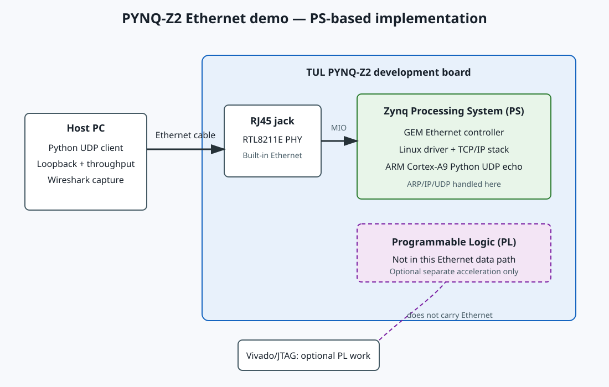

# PYNQ-Z2 Ethernet using the Processing System

This version uses the board's built-in Ethernet jack. The jack's RTL8211E PHY
is connected to the Zynq-7000 Processing System (PS) GEM Ethernet controller.
Linux on the ARM Cortex-A9 runs the Ethernet driver and network stack, and
`sw/udp_echo_server.py` provides a UDP application endpoint. This is real
networking hardware on the board, but it is not a custom PL Ethernet stack.

The repository intentionally contains no PL RGMII constraints, custom MAC RTL,
or Ethernet bitstream project: those would not connect to the onboard PHY.
Vivado is not needed for the network path. The PL remains available for other
logic, but using it to process PS Ethernet traffic would require a separate
AXI/DMA datapath and is outside this project's current scope.

## Data path



## Run the demo

1. Boot the PYNQ-Z2 with its supported PYNQ Linux image and connect the built-in
   RJ45 jack to the same LAN as the host PC. Connect power and configure the
   board's network using the normal Linux/DHCP setup.
2. Find the board's IP address from the PYNQ console with `hostname -I`.
3. Copy `sw/udp_echo_server.py` to the board, for example:

   ```sh
   scp fpga-gigabit-ethernet-pynq/sw/udp_echo_server.py xilinx@<board-ip>:/home/xilinx/
   ```

4. Start the echo service on the board:

   ```sh
   ssh xilinx@<board-ip> "python3 /home/xilinx/udp_echo_server.py --port 5001"
   ```

   Leave it running while testing. Stop it with Ctrl-C; it prints packet and
   byte totals on exit.
5. From the host PC, run the integrity test:

   ```sh
   python fpga-gigabit-ethernet-pynq/sw/udp_loopback_test.py --host <board-ip> --port 5001
   ```

6. Measure received application goodput:

   ```sh
   python fpga-gigabit-ethernet-pynq/sw/throughput_benchmark.py --host <board-ip> --port 5001 --seconds 5 --length 1472
   ```

Both test scripts use standard Python sockets. The throughput result includes
host, Linux, and UDP echo application overhead; it is not a PHY line-rate
measurement. Run Wireshark on the host's Ethernet interface to inspect ARP and
UDP packets. ARP is handled by Linux and the PS GEM driver, not custom PL RTL.

## Vivado's role

For this PS-only networking demonstration, Vivado is not used to create an
Ethernet bitstream. Use the board's PYNQ image and Linux networking tools.
Vivado Hardware Manager/JTAG may still be used for unrelated PL development,
but programming PL over JTAG does not route Ethernet traffic into PL.

## Recording validation results

After tests have actually run, record date, board image, host OS/Python version,
board IP setup, commands, packet count, byte count, loss, and measured goodput
in `results/README.md`. Attach Wireshark captures or screenshots when useful.
Do not enter expected/example numbers as measured results.
